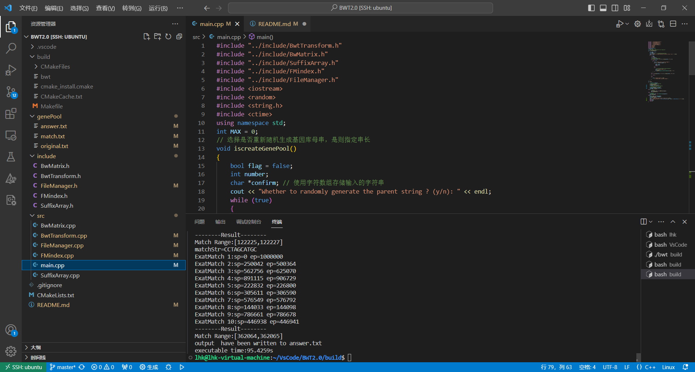
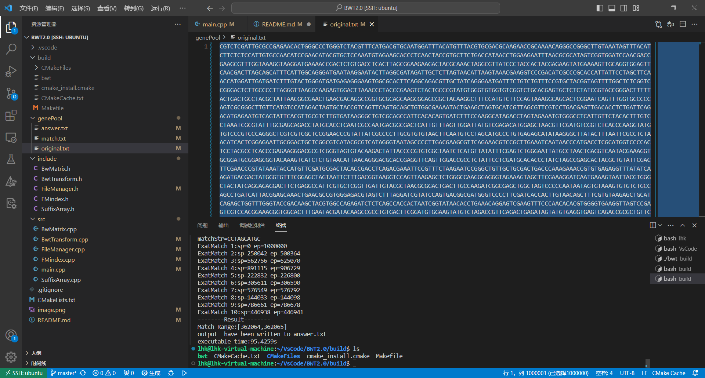
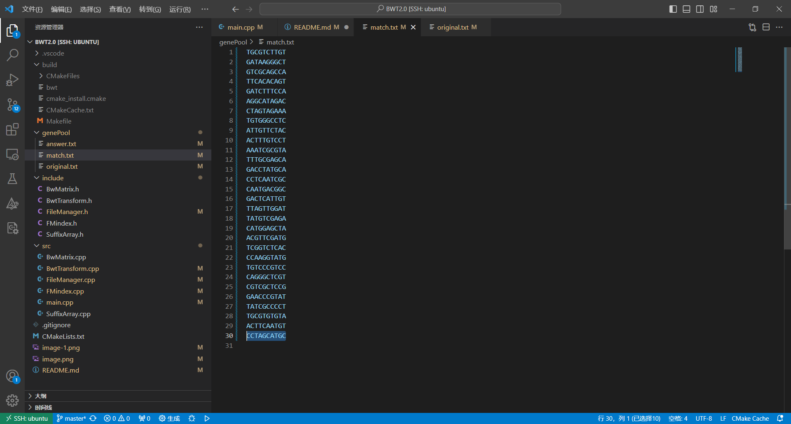
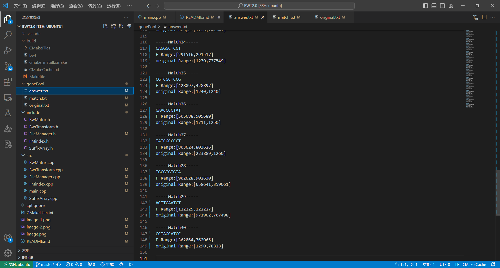

# BWT 匹配算法项目

## 项目简介

该项目实现了基于 Burrows-Wheeler Transform (BWT) 的字符串匹配算法，包括 BWT 的两种实现方式：通过 BWT 矩阵实现和通过后缀数列实现。通过 FMIndex 索引结构，实现了精准匹配算法，可以在给定的基因库中高效地查找匹配串的位置。

## 软件架构

- **BwtTransform 类**: 基类，封装了 BWT 的基本操作和共用数据结构。
  - **BwMatrix 类**: 通过 BWT 矩阵实现的子类。
  - **SuffixArray 类**: 通过后缀数组实现的子类。
- **FMIndex 类**: 封装了 FMIndex 索引结构的构建和精准匹配算法。
- **FileManager 类**: 文件读写和数据处理相关操作。
- **主程序 main.cpp**: 根据用户的选择，生成基因库母串、匹配串，并调用相应的 BWT 实现方式进行匹配。
- `src/`：包含项目源代码
- `include/`：包含头文件
- `genePool/`：存储生成的基因库文件
- `build/`：用于存放编译生成的可执行文件和中间文件

## 依赖

- C++ 编译器（支持 C++11 及以上标准）
- CMake

## 编译与运行

### 使用g++

~~~bash
# 进入项目根目录
cd bwt_-transform_-encode_-decode_-match

# 进入 src 目录
cd src

# 编译并执行
g++ -std=c++11 *.cpp -o bwt
./bwt
~~~


### 使用 CMake

```bash
# 进入项目根目录
cd bwt_-transform_-encode_-decode_-match

# 创建 build 目录
mkdir build

# 进入 build 目录
cd build

# 使用 CMake 配置项目
cmake ..

# 编译项目
make

# 运行可执行文件
./bwt
```

## 注意事项

- 确保 C++ 编译器支持 C++11 及以上标准。
- 在 Windows、Linux 等平台上均可运行，确保路径分隔符正确。
- 文件路径请在FileManager.h中修改为符合用户的正确路径。

## 使用说明

在运行时，程序会提示用户是否重新生成基因库母串。用户可以选择 "y" 或 "n"。如果选择重新生成，程序会要求输入一个正整数作为基因库母串的长度。

- 生成基因库母串：如果选择重新生成基因库母串，程序将在 `../genePool/original.txt` 中生成一个随机的基因库母串。
- 生成匹配串：程序提供了生成匹配串的选项，用户可以在  main.cpp中取消对fileManager->writeFile(30, 10);的注释，自定义`../genePool/match.txt` 中生成指定数量和长度的匹配串。

程序会输出匹配的范围和执行时间，并将匹配结果写入 `../genePool/answer.txt`。
## 使用实例

百万数据集母串

匹配示例子串

输出结果
