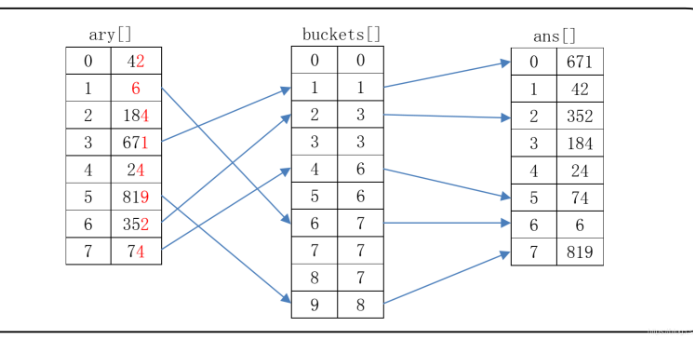

# BWT_Transform_Encode_Decode_Match

#### 介绍
随着NGS的高速发展，科学研究和医学临床等领域产生了大量数据，给数据分析带来了巨大挑战。
传统的序列比对算法，如动态规划方法，已不适用于NGS的大规模数据，因为其时间和空间复杂度为O(n^2)，而人类基因组的大小在10^9级别。

比对软件都需要面对一下几个问题：真核生物基因组中出现大量的重复区域；测序样本和参考序列的不一致；测序平台存在系统偏差
比对软件面对测序平台带来的两个问题：测序读长和测序错误（包括错配、插入和缺失）
当下比对软件的共同目的是：在允许一定的错配或者间隔的情况下，准确而快速地获取测序数据片段在参考序列中的位置
各测序平台存在不同类型的系统偏差，需要选择相应的误差模型。主要的误差模型有汉明距离和编辑距离。

两种主流的比对算法来解决近似匹配问题：基于过滤算法和基于索引算法
基于过滤算法的比对：
    过滤策略是将reads切割成固定长度的片段（k-mer或seed），在参考序列中寻找与种子匹配的区域作为完全匹配的候选区域。
    过滤算法包括基于鸽巢原理和基于q-gram的方法。

基于索引算法的比对：
    索引算法分为哈希算法和基于后缀树的算法，其中后缀树是近年来的研究热点。
基于索引算法建立索引的方法有两类
    简单的哈希算法：能够在参考序列中快速检索固定长度的seed      
    较为复杂的基于后缀树数据结构的索引算法:能够在发生匹配错误或插入缺失错误的情况下，检索任意长度的seed
    
    q-gram索引和FM-index是常见的索引技术，FM-index在比对软件中得到广泛应用。
    q-gram索引基于哈希算法，FM-index是一种基于Burrows-Wheeler Transform（BWT）的索引结构，它在构建时使用了后缀树或后缀数组。
    BWT的重要特性：可逆性变换


    基于BW矩阵来实现BWT的方法虽然浅显易懂，但需要借助m x m的旋转矩阵实现序列的排序，当T是人类基因组序列时，BWT将会消耗大量内存，所以基于BW矩阵的方法没有实用价值。

    在后缀数组中我们采用了基数排序的方法而不是传统的sort快速排序，提升效率10倍有余

    基数排序


前缀和：在排列好的序列F列中首次出现的位置
#### 软件架构
软件架构说明


#### 安装教程


#### 使用说明
```
cd build
cmake ..
make
./BWT2.0 
```
#### 参与贡献

1.  Fork 本仓库
2.  新建 Feat_xxx 分支
3.  提交代码
4.  新建 Pull Request


#### 特技

1.  使用 Readme\_XXX.md 来支持不同的语言，例如 Readme\_en.md, Readme\_zh.md
2.  Gitee 官方博客 [blog.gitee.com](https://blog.gitee.com)
3.  你可以 [https://gitee.com/explore](https://gitee.com/explore) 这个地址来了解 Gitee 上的优秀开源项目
4.  [GVP](https://gitee.com/gvp) 全称是 Gitee 最有价值开源项目，是综合评定出的优秀开源项目
5.  Gitee 官方提供的使用手册 [https://gitee.com/help](https://gitee.com/help)
6.  Gitee 封面人物是一档用来展示 Gitee 会员风采的栏目 [https://gitee.com/gitee-stars/](https://gitee.com/gitee-stars/)
